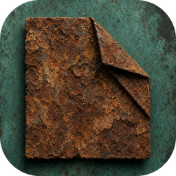

<p align="center">
  
</p>

<h1 align="center">ObsiRust</h1>

Réimplémentation d'Obsidian en Rust, compatible avec les vaults existants.

Voir [PLAN.md](PLAN.md) pour l'architecture et la feuille de route.

## Installation

Téléchargez l'archive de votre système dans les
[Releases](https://github.com/LeVibeux/ObsiRust/releases) (macOS Apple Silicon et
Intel, Windows, Linux). Elle contient l'application et le CLI `obsirust`.

Sur Ubuntu / Debian, installez le paquet `.deb` (double-clic, ou
`sudo apt install ./obsirust_<version>_amd64.deb`) : ObsiRust apparaît dans le menu
des applications et `obsirust` est disponible dans le terminal.

Pour publier une version : mettez d'abord à jour `version` dans `Cargo.toml`
(`[workspace.package]`), puis onglet *Actions* → *Release* → *Run workflow* avec la
même version (`v0.1.0`, ou `v0.1.0-rc.1` pour une pré-release), ou poussez un tag
`vX.Y.Z`. Le workflow `.github/workflows/release.yml` vérifie la version, compile et
publie la release.

## Développement

```sh
cargo test --workspace
cargo run -p ors-cli -- stats examples/sample-vault
cargo run -p ors-app -- examples/sample-vault
```
